```{r}
#| label: setup
# Rendered from docs/: quarto render docs/User_Guide.qmd
# The screenshots in docs/img come from: Rscript tests/browser_e2e.R --screenshots docs/img
root <- normalizePath("..")
owd <- setwd(root)
suppressMessages({
  sys.source("helpers/code_lists.R", envir = globalenv())
})
lists <- code_lists_default()
code_list_info <- data.frame(
  List = CODE_LIST_DEFS$label,
  `Nansen list` = ifelse(CODE_LIST_DEFS$id == "acocat", "EAF-Nansen acoustic categories", "NMD reference"),
  Codes = vapply(CODE_LIST_DEFS$id, function(id) nrow(code_list_nansen(id)), integer(1)),
  `Used in` = gsub("->", "→", CODE_LIST_DEFS$used_in),
  check.names = FALSE
)
template_cols <- vapply(
  c("Stations_model", "Catches_model", "Length-frequency_model", "Biology_model", "NASC_model"),
  function(b) sprintf("- **%s.xlsx**: %s", b,
                      paste(names(readxl::read_excel(file.path("data", paste0(b, ".xlsx")), n_max = 1)), collapse = ", ")),
  character(1)
)
# Every check the Validation panels can report, read from helpers/validation.R
v_src <- paste(readLines("helpers/validation.R", warn = FALSE), collapse = "\n")
v_hits <- regmatches(v_src, gregexpr('"(error|warning|info)", "([a-z -]+)", "([A-Z0-9_]+)"', v_src))[[1]]
v_parts <- do.call(rbind, strsplit(gsub('"', "", v_hits), ", "))
checks <- unique(data.frame(severity = v_parts[, 1], category = v_parts[, 2], code = v_parts[, 3]))
checks <- checks[order(checks$category, match(checks$severity, c("error", "warning", "info")), checks$code), ]
sev_label <- c(error = "error", warning = "warning", info = "note")
check_list <- vapply(split(checks, checks$category), function(d) {
  sprintf("- **%s**: %s", d$category[1], paste0(d$code, " (", sev_label[d$severity], ")", collapse = ", "))
}, character(1))
setwd(owd)
```

# Overview

Nansen Converter turns survey data into the two NMD XML formats that StoX reads:
**NMDBiotic v3.1** for trawl stations, catches and individual fish, and **NMD Echosounder
v1** for acoustic NASC. Field data and NASC exports take two steps, with an Excel
workbook in between that you can check and correct before the XML is written. Surveys
stored in a NansIS database go straight to `Biotic.xml`.

| Tab | Input | Output |
|---|---|---|
| BioData_To_Biotic.xls | Stations, catches, length-frequency and biology sheets | `Biotic.xlsx` |
| Biotic.xls_To_Biotic.xml | `Biotic.xlsx` | `Biotic.xml` |
| Nansis2Biotic.xml | A NansIS database | `Biotic_<survey>.xml` |
| NASC.xls_To_Acoustic.xml | Echoview NASC export | `Acoustic.xlsx` |
| Acoustic.xls_To_Acoustic.xml | `Acoustic.xlsx` | `Acoustic_<date-time>.xml` |

: The converters {#tbl-steps}

Three more tabs support them. **Code lists** chooses the codes used for every coded
field, **Excel file templates** downloads example inputs, and **User_Guide** downloads
this guide.

Both XML steps validate the data before you download it: keys and links between
tables, codes, plausibility checks on stations, catches, fish and acoustic intervals,
species names, the official NMD schema, and a read-back of the file with RstoxData.
Errors block the download unless you allow it.

## Starting the app

The app needs R 4.6 and the packages listed in the README. Two of them come from the
EAF-Nansen tool suite on the IMR GitLab: **nansencore** (NMD reference codes, maritime
zones) and **nansentaxonomy** (species names, aphia codes and acoustic categories). The
Nansis2Biotic.xml tab also needs **rnansisclient** from the same place; the other tabs
work without it.

Open `nansenconvert.Rproj` in RStudio and run `shiny::runApp()`, or run
`Rscript -e "shiny::runApp()"` from the project folder. The app opens on a start screen
(@fig-splash); click **Launch the application**.

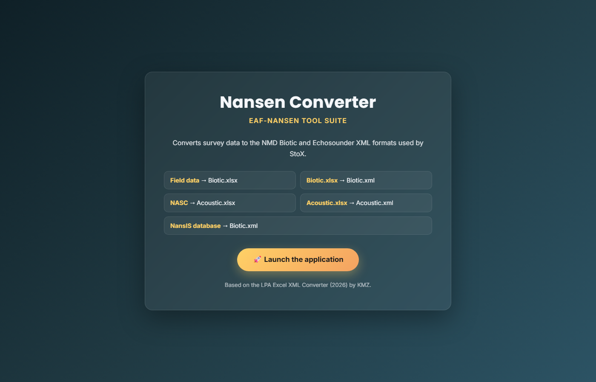{#fig-splash width=90%}

## Before you start

- **Start from the templates.** The *Excel file templates* tab has an example of every
  input, filled with a fictional survey. Their column names are the ones the converters
  look for (@sec-templates).
- **Choose your code lists first** if your data use codes other than the NMD reference
  ones (@sec-codelists). The converters use whatever the Code lists tab holds at the
  time.
- **Regenerate old files.** Workbooks and XML made with the earlier LPA Excel XML
  Converter differ in sex codes, acoustic category codes, species NASC values, interval
  lengths, times and catch weights. Convert the original data again rather than reusing
  them.

# Field data → Biotic workbook {#sec-biodata}

The **BioData_To_Biotic.xls** tab has four sub-tabs, used in order. The first three
each make one Excel file; the fourth combines them into `Biotic.xlsx`.

## Fishstations

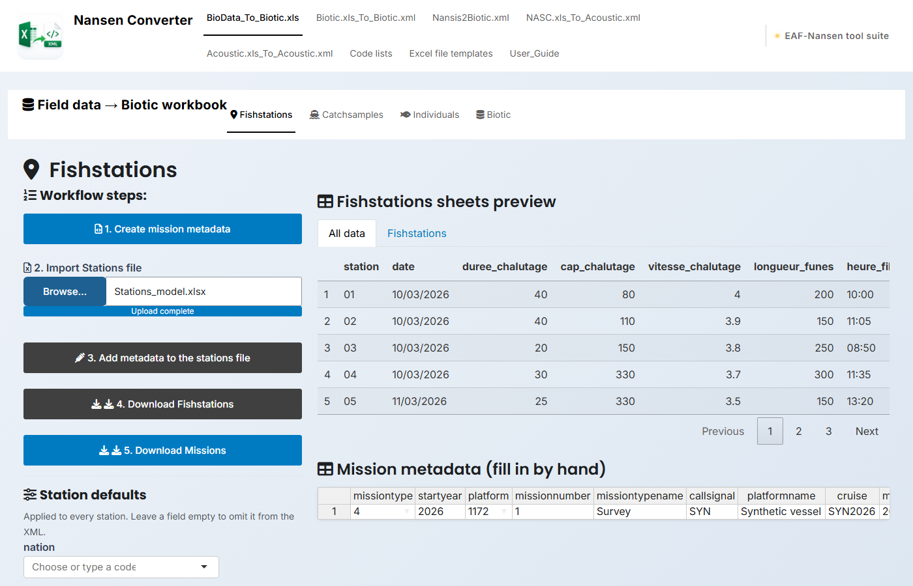{#fig-fishstations width=100%}

Follow the numbered buttons (@fig-fishstations):

1. **Create mission metadata.** A one-row table appears under the preview. Fill in
   `missiontype` and `platform` (both offer the codes of the active code lists),
   `startyear`, `missionnumber`, `missiontypename`, `callsignal`, `platformname`,
   `cruise`, `missionstartdate`, `missionstopdate` (for example `2026-03-10Z`) and
   `purpose`.
2. **Import Stations file** (`.xlsx`, `.xls` or `.csv`).
3. **Add metadata to the stations file.** This copies the mission number and platform
   to every station.
4. **Download Fishstations** and 5. **Download Missions**.

The **Station defaults** in the sidebar apply to every station: `nation`, `area`,
`gear` (default 3500), `gearcount` (1), `haulvalidity` (1), `stationtype`,
`trawldoorspread` (15 m) and `verticaltrawlopening` (50 m). Nation and area have no
default; leave a field empty to leave it out of the XML.

Column names are matched without regard to case or accents (`Durée_chalutage` is read
as `duree_chalutage`). The Stations file columns become these NMDBiotic fields:

| Stations column | NMDBiotic field |
|---|---|
| `Station` | `serialnumber` |
| `Date` | `stationstartdate`, `stationstopdate` |
| `Heure_filage`, `Heure_virage` | `stationstarttime`, `stationstoptime` |
| `Latitude_filage`, `Longitude_filage` | `latitudestart`, `longitudestart` |
| `Latitude_virage`, `Longitude_virage` | `latitudeend`, `longitudeend` |
| `Prof_fond_filage`, `Prof_fond_virage` | `bottomdepthstart`, `bottomdepthstop` |
| `Prof_filet_filage`, `Prof_filet_virage` | `fishingdepthmin`, `fishingdepthmax` |
| `Durée_chalutage` (minutes) | `soaktime` (hours) |
| `Vitesse_chalutage` | `vesselspeed` |
| `Cap_chalutage` | `direction` |
| `Longueur_funes` | `wirelength` |
| `Note` | `stationcomment` |

: Stations columns and the fields they fill {#tbl-stations}

The towed `distance` (nautical miles) is computed from the start and end positions.
Missing positions are highlighted in yellow in the preview, and you can edit any cell
there. When a start or stop time is missing, it is filled in as 30 minutes before or
after the other one.

## Catchsamples

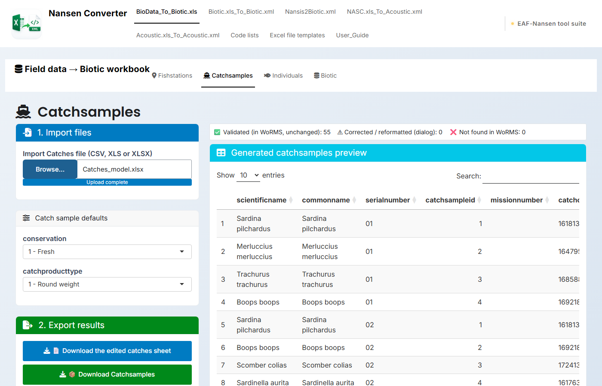{#fig-catchsamples width=100%}

Import the Catches file (`.csv`, `.xls` or `.xlsx`). The columns are found by name:

| Meaning | Column (accepted names) | |
|---|---|---|
| Species | `Espece` (also espèce, esp, scientificname, species) | required |
| Station | `Station` (also serial, serialnumber) | required |
| Sample weight, kg | `Ech_P` | required |
| Number in the catch | `Tot_N` | required |
| Total catch weight, kg | `Tot_P` | optional |

: Catches columns {#tbl-catches}

`catchweight` is the whole catch (`Tot_P`, or `Ech_P` when there is no `Tot_P`),
`catchcount` is `Tot_N`, and `raisingfactor` is `Tot_P / Ech_P`. The aphia code and
`catchcategory` of each species come from nansentaxonomy. The sidebar sets
`conservation` and `catchproducttype` (both 1 by default).

**Species names.** The names are checked against the EAF-Nansen taxonomy. If some are
not found, a dialog lists them with the likely correct name pre-selected; type the
start of a name to search the list. **Check these names in WoRMS** looks them up
online, and names found only in WoRMS can be downloaded as a CSV for the next
nansentaxonomy release. **Apply replacements** uses your choices; **Continue without
corrections** keeps the imported names, which leaves those species without an aphia
code (an error in the Biotic XML validation).

Download the result with **Download Catchsamples**. **Download the edited catches
sheet** saves your input with the corrected names.

## Individuals

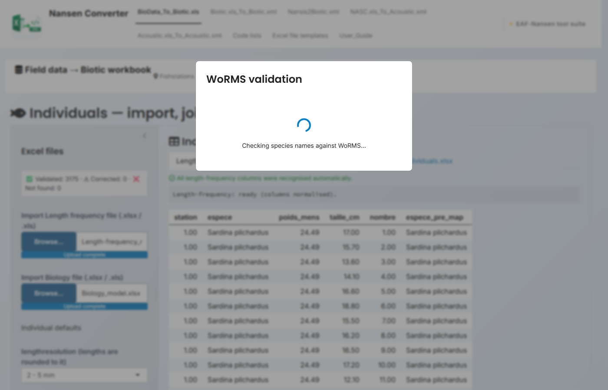{#fig-individuals width=100%}

Import a **Length-frequency** file (`station`, `espece`, `Poids_Mens`, `taille_cm`,
`nombre`) and a **Biology** file (`espece`, `station`, `nombre`, `poids_g`, `sexe`,
`sms`; other columns are ignored). If a column has another name, choose it in the
column-matching panel of the preview tabs. Species names are checked as in
Catchsamples.

**Join Biology with Length** pairs the rows of the two files with the same station,
species and `nombre`. When several rows share the same `nombre`, the first is paired
with the first, the second with the second, and so on. Then:

- `taille_cm` becomes `length` in metres, rounded to the **lengthresolution** chosen in
  the sidebar (default 2, 5 mm);
- `poids_g` becomes `individualweight` in kilograms;
- `sexe` becomes `sex` through the Sex code list (F → 1 Female, M → 2 Male, I left
  empty);
- `sms` becomes `maturationstage` through the Maturation stage code list;
- `Poids_Mens` is kept as the weight of the length sample.

**Export Individuals.xlsx** saves the joined fish. The *Export Individuals.xlsx*
preview tab shows the exported columns and their order.

## Biotic

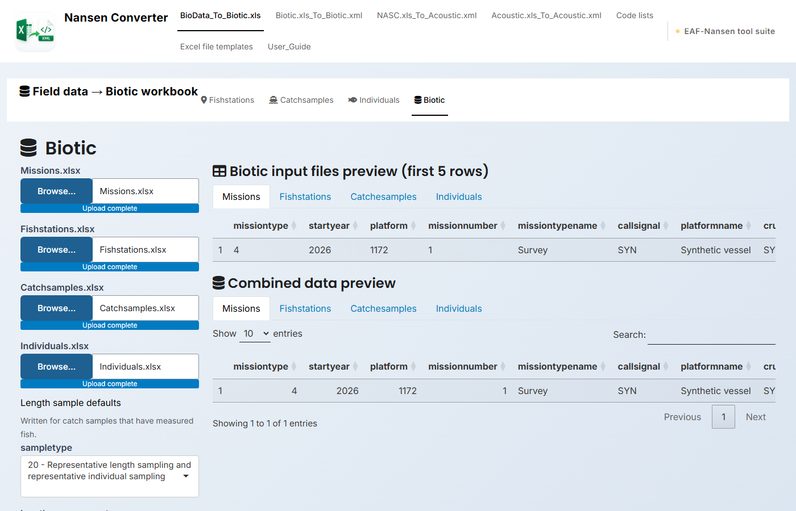{#fig-biotic-workbook width=100%}

Import the four files you downloaded (Missions, Fishstations, Catchsamples,
Individuals), check the **sample defaults** (`sampletype` 20, `lengthmeasurement` E,
`sampleproducttype` 1, applied to the catch samples with measured fish) and click
**Combine the data**. **Download Biotic** saves `Biotic.xlsx` with the four sheets
`missions`, `fishstations`, `catchesamples` and `individuals`. The preview tabs show
each sheet; you can also edit the workbook in Excel before the next step.

# Biotic workbook → Biotic.xml {#sec-bioticxml}

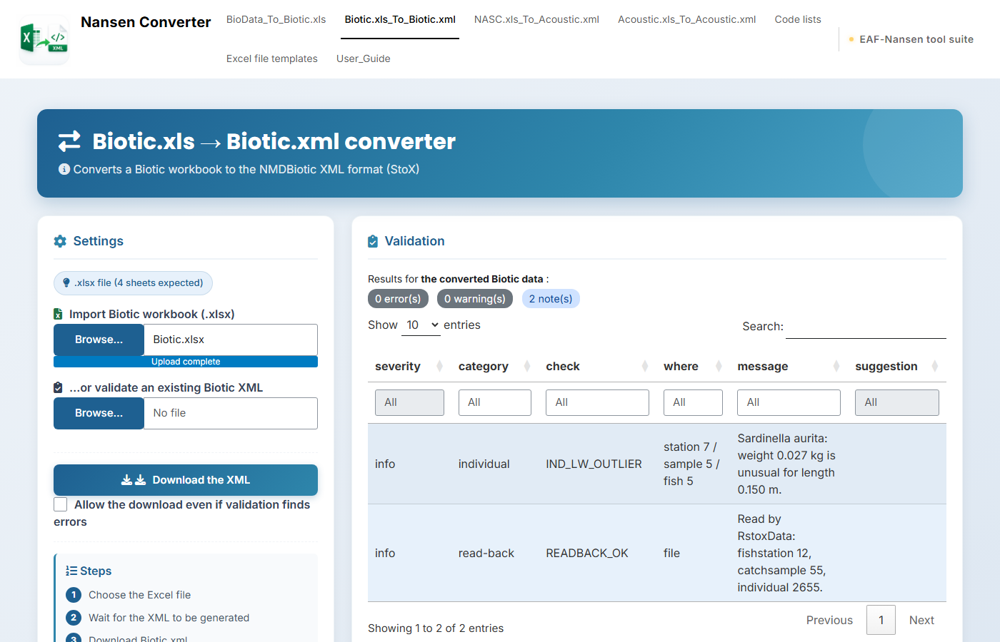{#fig-biotic-xml width=100%}

Import `Biotic.xlsx` in the **Biotic.xls_To_Biotic.xml** tab. The XML is built and
validated straight away (@fig-biotic-xml):

- The **Validation** panel shows the number of errors, warnings and notes, and a
  table of the findings with where they are and what to do. Filter it by severity or
  category, or **Download findings (CSV)**.
- **Check unresolved names in WoRMS** looks up online any species name the taxonomy
  could not resolve.
- **Download the XML** saves `Biotic.xml`. It is blocked while there are errors;
  tick **Allow the download even if validation finds errors** to download anyway.
- **…or validate an existing Biotic XML** runs the same checks on an NMDBiotic file
  made elsewhere.

The *Generated XML preview* shows the start of the file. Errors are problems StoX
would reject or that make the data wrong, such as broken links between tables or a
missing aphia code. Warnings are values worth checking, such as a station on land or a
fish far too heavy for its length. Notes are for information. All checks are listed in
@sec-checks.

# NansIS database → Biotic.xml {#sec-nansis}

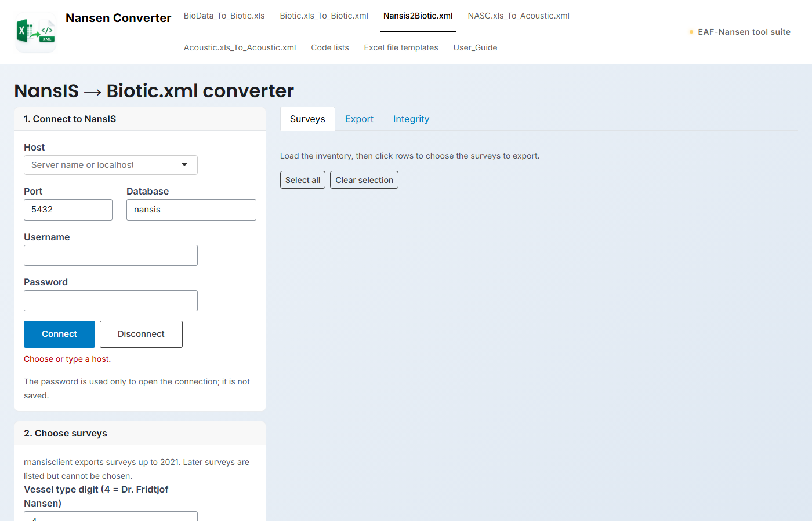{#fig-nansis width=100%}

Some countries keep their national survey data in NansIS. The **Nansis2Biotic.xml** tab
exports those surveys straight from the NansIS database to NMDBiotic v3.1. The export
itself is done by **rnansisclient**, the EAF-Nansen tool that replaced the old Java NansIS
client, so the files are the same as from its own app; this tab adds nansenconvert's
validation to every file.

1. **Connect to NansIS.** Type the name of your NansIS server (your database
   administrator can give it to you), or choose `localhost` for a copy on your
   computer. Then fill in the port and database name, and your username and password. The password is only used to open the connection and is
   cleared from the form straight away; it is never saved.
2. **Choose surveys.** Set the vessel type digit (4 is the Dr. Fridtjof Nansen; other
   vessel types are not fully supported by rnansisclient yet), optionally pick
   regions, and click **Load survey inventory**. The *Surveys* tab lists the surveys;
   click rows to choose them, or type survey numbers in the box. A region filter keeps
   a survey when any of its stations falls in a chosen zone, judged from the station
   positions; the file still holds every station of that survey. Survey numbers have
   seven digits, `YYYYTNNN` (year, vessel type, mission), and rnansisclient exports
   surveys up to 2021: later ones are listed in grey and cannot be chosen.
3. **Export.** A start serial number applies when you export a single survey. **Include
   no-catch stations** keeps stations fished without catch as empty stations, which is
   valid NMDBiotic.
4. **Check and download.** The *Export* tab lists each survey with its stations, catch
   samples, individuals, rnansisclient's warnings and the validation counts. Click a
   survey to see its Validation panel and rnansisclient's export log. **Download the
   shown survey's XML** is blocked while it has errors, as in the Biotic XML tab;
   **Download all files (ZIP)** gives every XML with the validation findings, a
   manifest and rnansisclient's reports:
   - `_missing_species.csv`: NansIS species codes not in rnansisclient's species map.
     Send it to the rnansisclient maintainer for the next annual update.
   - `_code_collisions.csv`: one taxon recorded under two NansIS species codes.
   - `_nansis_corrections.sql`: a script that would replace superseded species codes in
     NansIS. It is a dry run that ends in `ROLLBACK`; nothing is changed unless someone
     edits it to `COMMIT` and runs it.

The codes in the file come from rnansisclient's NansIS-to-NMD translation, not from the
Code lists tab; the validation still checks them against the active code lists.

**Integrity checks.** The *Integrity* tab checks the NansIS data itself for the chosen
surveys: duplicate keys, codes missing from their lookup tables, orphan rows,
impossible values, gear below the sea bed and more. It only reads the database. The
results show per check, and **Download integrity report (ZIP)** gives a CSV per issue
plus a dry-run correction script.

# NASC → Acoustic workbook {#sec-nasc}

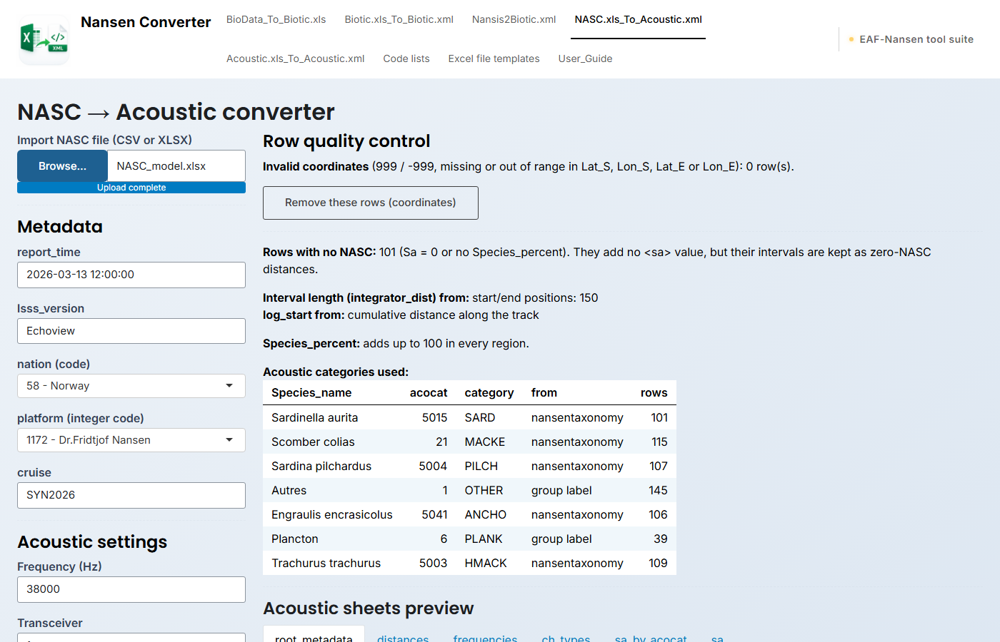{#fig-nasc width=100%}

The **NASC.xls_To_Acoustic.xml** tab reads an Echoview export with one row per
interval, layer, region and species (`.csv` or `.xlsx`). It needs these columns:

`Interval`, `Layer`, `Date_S`, `Time_S`, `Date_E`, `Time_E`, `Lat_S`, `Lon_S`, `Lat_E`,
`Lon_E`, `PRC_NASC`, `Species_name`, `Species_percent`, `Exclude_above_line_depth_mean`,
`Exclude_below_line_range_mean`, `Exclude_below_line_range_max`,
`Exclude_below_line_depth_min`.

`Region_ID` is optional; with it the app checks that `Species_percent` adds up to 100
in every region. `VL_start`/`VL_end` (vessel log) or `Dist_S`/`Dist_E` (GPS distance),
when present, give the interval lengths.

1. **Import** the NASC file.
2. Fill in the **Metadata**: `report_time`, `lsss_version`, `nation` and `platform`
   (codes from the code lists) and `cruise`.
3. Check the **Acoustic settings**: frequency (38000 Hz), transceiver (1), Sv threshold
   (−70 dB), pelagic channel thickness (10 m), upper interpretation depth (10 m), lower
   integration depth (500 m), and whether species get specific acoustic categories
   (for example PILCH, ANCHO) or only the broad ones (PEL1, PEL2, MESFI, BOTT, OTHER).
4. Click **Process file**, review the checks, then **Download Acoustic.xlsx**.

Each species' NASC is its share of the region, `PRC_NASC × Species_percent / 100`,
summed by interval, acoustic category and channel. The category comes from
nansentaxonomy, or from the group labels used in Echoview (for example *Autres* →
OTHER, *Plancton* → PLANK). The **Row quality control** panel (@fig-nasc) reports:

- rows with invalid coordinates (999, −999, missing or out of range), which you can
  remove;
- rows with no NASC, whose intervals stay in the file as zero-NASC distances;
- where the interval lengths and `log_start` come from (vessel log, GPS distance, or
  the start and end positions);
- regions whose `Species_percent` does not add up to 100;
- the acoustic category given to each species, and where it came from.

`Acoustic.xlsx` has six sheets: `root_metadata`, `distances`, `frequencies`,
`ch_types`, `sa_by_acocat` and `sa`. The preview tabs show each one.

# Acoustic workbook → Acoustic XML {#sec-acousticxml}

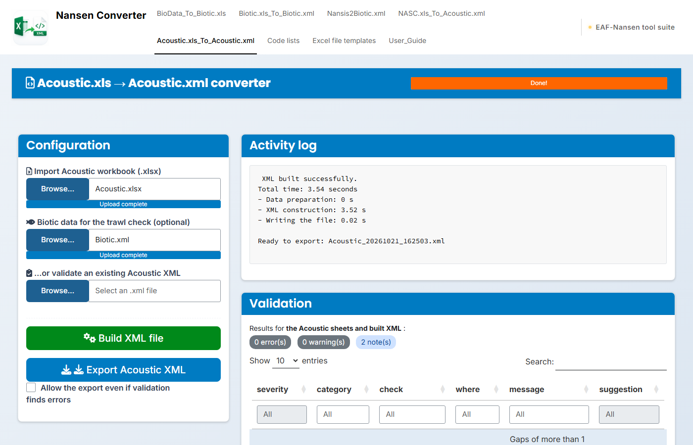{#fig-acoustic-xml width=100%}

In the **Acoustic.xls_To_Acoustic.xml** tab:

1. **Import** `Acoustic.xlsx`.
2. Optionally add the **Biotic data for the trawl check** (`Biotic.xlsx` or
   `Biotic.xml`). The validation then reports acoustic categories with no trawl catch
   to support them, and trawls outside the acoustic period.
3. Click **Build XML file**. The *Activity log* shows the progress.
4. Review the **Validation** panel and **Export Acoustic XML**. As for Biotic, errors
   block the export unless you tick **Allow the export even if validation finds
   errors**.

**…or validate an existing Acoustic XML** checks an NMD Echosounder file made
elsewhere.

# Code lists {#sec-codelists}

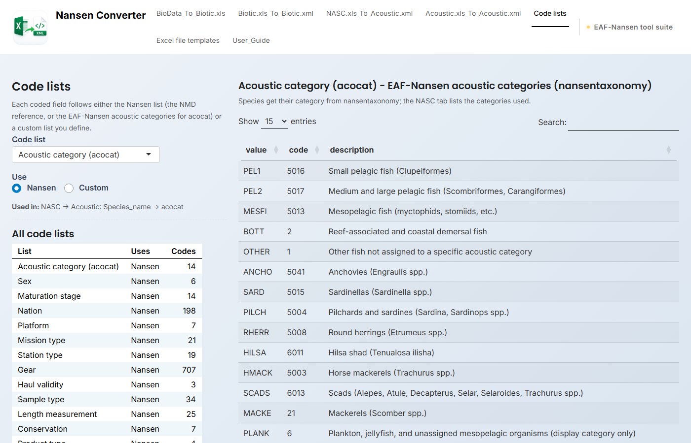{#fig-code-lists width=100%}

Every coded field uses one of the code lists below. For each list, choose under **Use**:

- **Nansen**: the NMD reference codes (from nansencore), or for acoustic categories the
  EAF-Nansen categories (from nansentaxonomy). This is the default.
- **Custom**: your own table. **Fill the custom list from the Nansen list** gives you a
  starting point; for acocat you can also start from the old LPA codes. Right-click the
  table to add or remove rows.

For the mapped lists (acocat, sex, maturation stage), `value` is what appears in your
input file and `code` is what is written to the XML; a `value` of `*` gives the code
for any value that is not listed.

```{r}
#| label: tbl-codelists
#| tbl-cap: "The code lists, with the number of codes in the Nansen version"
#| tbl-colwidths: [26, 24, 8, 42]
knitr::kable(code_list_info, row.names = FALSE)
```

**Export code lists (CSV)** saves all lists and their settings; **Import code lists
(CSV)** loads them back, for example on another computer. Your choices are also saved
on this computer and reloaded the next time the app starts.

# Excel file templates {#sec-templates}

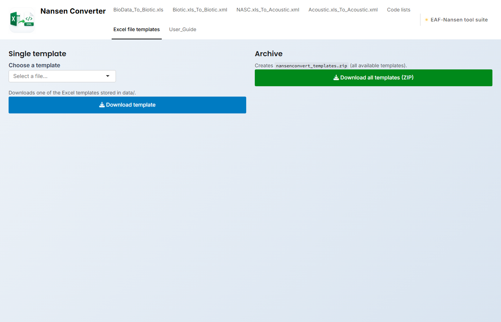{#fig-templates width=100%}

Download one template, or all of them as `nansenconvert_templates.zip`. They hold a
fictional three-day survey (12 stations off northwest Africa, 10–12 March 2026), so you can try every
converter without real data and see the expected columns:

```{r}
#| results: asis
cat(template_cols, sep = "\n")
```

# Common problems

**"Missing columns" when processing a NASC file.** Rename the columns of your export
to the names in @sec-nasc, or export them from Echoview.

**A species keeps coming back as not found.** Check its spelling in the species dialog
or with **Check these names in WoRMS**. If it is a valid name that nansentaxonomy does
not hold yet, download it from the dialog and send it to the nansentaxonomy
maintainers.

**The XML download is greyed out.** Validation found errors. Read the *suggestion*
column of the findings, fix the workbook and import it again. Download anyway only
when you know the error does not matter for your use.

**Wrong codes in the XML.** Check the Code lists tab: a list set to *Custom* replaces
the Nansen codes everywhere it is used.

**Nation or area missing.** They have no default; set them under *Station defaults*
(Fishstations) and in the NASC metadata.

**"Connection failed" in the NansIS tab.** Check the host, port, database name,
username and password. The message gives the database server's reason; a server inside
an institute's network may only be reachable from there or over VPN.

# Validation checks {#sec-checks}

The Validation panels can report the checks below, grouped by the *category* shown in
the findings table, with their severity. The thresholds behind them (plausible
speeds, depths, lengths and weights) are in `helpers/validation.R`.

```{r}
#| results: asis
cat(check_list, sep = "\n")
```

# Credits

Nansen Converter is part of the EAF-Nansen tool suite. It is based on the LPA
**Excel XML Converter** (2026) by KMZ.
